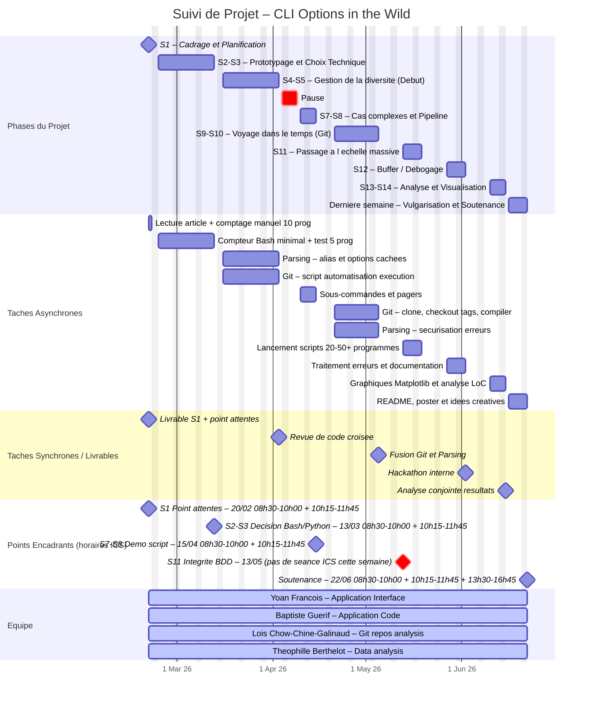

# Suivi de Projet : CLI Options in the Wild

| Semaine / Date | Objectifs de la période | Tâches Asynchrones individuelles (Binôme) | Tâches Synchrones / Points de contact |
| :--- | :--- | :--- | :--- |
| **S1** (20/02)  | Cadrage & Planification  | Lecture de l'article de base, comptage manuel de 10 programmes et premier programme test. | Livrable du 20/02 et point sur les attentes. |
| **S2-S3** (23/02-13/03)  | Détermination des tâches, Prototypage & Choix Technique  | Création du compteur Bash minimal et test sur 5 programmes simples (cat, ls, grep, sed, sort). Étude de faisabilité Python argparse vs Bash. | Point avec encadrants, présentation des écarts manuel/auto et décision finale Bash ou Python. |
| **S4-S5** (16/03-03/04)  | Gestion de la diversité (Début)  | Pôle Parsing : Implémentation de la gestion des alias (ex: tar) et options cachées (curl --help all). Pôle Git : Apprentissage du script d'automatisation d'exécution. | Mise en commun sur le dépôt Git et revue de code croisée. |
| **S7-S8** (10/04-15/04)  | Cas complexes & Pipeline  | Résolution du problème des sous-commandes (ex: git clone, init) et des pagers (ne pas rester bloqué). | Point d'étape encadrants et démonstration du script validé sur l'ensemble des cas d'usage simples et complexes. |
| **S9-S10** (21/04-05/05)  | Voyage dans le temps (Git)  | Pôle Git : Script pour cloner 1 dépôt, checkout 3-5 tags, et compiler. Pôle Parsing : Sécurisation du parseur contre les erreurs de compilation / format cassé. | Fusion Git & Parsing : le script de parsing est injecté dans le script temporel Git. |
| **S11** (13/05)  | Passage à l'échelle massive  | Action de groupe : Lancement des scripts sur la liste cible de 20 à 50+ programmes (Catégories : Réseau, Serveurs, Médias, CLI modernes) et génération des CSV/JSON. | Point d'étape encadrants non-noté : Vérification de l'intégrité de la base de données générée. |
| **S12** (27/05)  | Semaine de Buffer/Débogage  | Traitement des cas d'erreur (programmes qui refusent de compiler ou dont le format d'aide a muté au fil des décennies) et documentation du code. | Session "Hackathon" interne pour finaliser la collecte de données. |
| **S13-S14** (10/06-15/06)  | Analyse & Visualisation  | Utilisation de Matplotlib pour générer les graphiques et comparaison de la croissance des options vs Lignes de Code (LoC). | Analyse conjointe des résultats : L'IA a-t-elle eu un impact ? Quels programmes explosent ?  |
| Dernière semaine  | Vulgarisation de notre travail et finalisation du suivi.md  | Faire le readme.md et faire un poster (autres idées créatives). | Répétition de la soutenance (si applicable) et vérification de l'arborescence du GitLab. |

